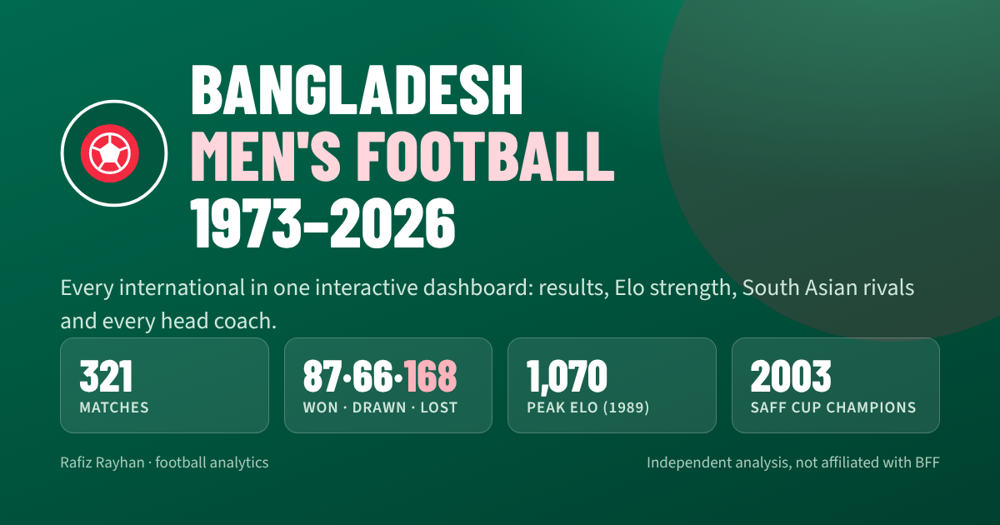

# Bangladesh Men's Football 1973–2026

An interactive dashboard of every full international played by the Bangladesh men's national football team, from the first match in July 1973 to the 2026 SAFF Championship semi-final on 14 November 2026.

**Live dashboard:** https://rafizrayhan.github.io/bangladesh-football/

## Why this exists

Results tables tell you what happened. They don't tell you whether a 1-1 draw was a good result or a bad one. This dashboard rates every match by the strength of the opponent, so Bangladesh's record can be judged fairly across five decades, against South Asian rivals, and under each head coach.

## What's inside

| Page | What it answers |
|---|---|
| Overview | The overall record, results by decade, last 10 results, most-played opponents, home vs away vs neutral, records and streaks (biggest wins and defeats, longest runs, most common scorelines, penalty shootouts), all-time record holders (most caps, top scorers, most clean sheets) |
| Strength | Elo rating after every match, highest and lowest points, points won vs expected, biggest upset wins and shock defeats, whether home advantage holds up once opponent strength is allowed for, the FIFA ranking, and a check of our Elo against the published World Football Elo Ratings |
| Opponents | Record against weaker, similar and stronger teams; head to head with every opponent; record by region of Asia |
| South Asia | Where Bangladesh rank among the 8 South Asian teams, Elo trends with a team comparison picker, a peer table |
| Competitions & coaches | Record by competition, finish by edition for the selected competition, a fact sheet for each tournament (edition by edition, best moments, titles and runner-up finishes, sources), and every head coach's spell measured against expectation |
| Every match | The full match list with pre-match win, draw and loss chances and the Elo change from each game |

Filters for year range, competition and venue apply across the dashboard. Clicking a bar, row or result opens the matches behind it.

## Headline numbers (all years)

- 322 matches: 87 won, 66 drawn, 169 lost (to 14 November 2026)
- Elo rating after 14 November 2026: 942
- Highest rating 1,070 (October 1989), lowest 811 (September 2018)
- 120.0 points won against 118.4 expected (1 per win, ½ per draw)
- FIFA ranking: 182nd (7 October 2026); highest 110th (April 1996), lowest 197th (February–May 2018)
- SAFF Cup champions in 2003, runners-up in 1999 and 2005; semi-finalists as hosts in 2026 (lost 0-1 to Pakistan)
- South Asian Games gold in 1999; one Asian Cup finals (1980); best World Cup qualifying run: the second round (2014, 2018, 2022, 2026)
- Trophies won in friendly events: the 1995 Burma Tournament in Yangon (the first won abroad) and the 2020 Mujib Borsho series

## Method

**Data.** Match results come from the open [international results dataset](https://github.com/martj42/international_results). Two 2007 Merdeka Tournament matches were removed because they were played by the Bangladesh B team. The most recent results were checked against news reports.

**Cross-checks.** The match list was compared year by year with the World Football Elo archive, and disputed years with RSSSF and 11v11.com. A match was added or changed only when two independent sources agreed on date, opponent and score: nine Bangladesh matches were added in total. Five came from the year-by-year check (Bahrain 2-0 and Sri Lanka 1-3 in 1979, North Korea 1-0 in 1985, Yemen 0-1 in 1994, India 1-0 in 2009), and one date was corrected (Nepal, SAFF Cup 1995). Every 2025 and 2026 match was then checked against news reports, which added four more: Singapore 1-0 Bangladesh (31 March 2026, missing from the dataset) and Bangladesh's three games at the 2026 SAFF Championship in Dhaka, played after the dataset's last update (1-0 v Bhutan, 4-0 v Sri Lanka, 0-1 v Pakistan in the semi-final). The other South Asian teams' games at that tournament were added too, up to the semi-finals; the final (India v Pakistan, 17 November) does not involve Bangladesh. India sent a second-string senior squad because their first team was playing friendlies in New Zealand; these are still full India internationals. Seven years still differ from the Elo archive by a match or two with no second source to settle them. All corrections are listed in `manual/` in the data files.

**Elo check.** Our end-of-year ratings were compared with the published World Football Elo Ratings for the eight South Asian teams, 1973–2023: correlation 0.97 across 376 team-years, and Bangladesh's position in South Asia at the end of 2023 is 3rd in both.

**Record holders.** Most caps, top scorers and most clean sheets come from Wikipedia's lists. Matches since its 5 June 2026 update were checked in match reports to 14 November 2026: Rakib Hossain's goal against Sri Lanka was his seventh (joint 9th), and Mehedi Hasan Srabon's clean sheets against Bhutan and Sri Lanka were his first two (joint 10th). Caps were cross-checked against RSSSF (Jamal Bhuyan: 94 match by match to 5 June 2026, 97 with his three SAFF games, which Wikipedia now also shows) and National-Football-Teams.com, which agrees on the top three but differs by 1 to 8 caps for several older players, so places 4 to 10 are approximate. Rakib Hossain is listed with Wikipedia's 55 caps; match reports suggest 56. Sohel Rana's and Topu Barman's caps are as of 5 June 2026. Scorers named in the open dataset fit within the goals list, and clean sheets were checked against the clean sheets in our match list.

**Elo ratings.** Every international since 1872 was rated using the World Football Elo method: match weight by competition (K from 20 for friendlies to 60 for World Cup finals), a goal-difference multiplier and 100 points of home advantage. Teams that joined later start from the level they showed in their first 30 matches, found by iterating until the ratings settle.

**Win, draw and loss chances.** An ordered logit model on the pre-match rating gap, fitted on all internationals since 1990. Predicted and actual outcomes agree within 3 percentage points across every decile.

**Tournament fact sheets.** The stage reached in each edition comes from Wikipedia's record tables and was checked edition by edition against the match list: 29 editions with a published per-edition total agree exactly on games, results and goals. Known differences (four South Asian Games editions, the 1980 Asian Cup qualifiers) are stated on the site. Titles and runner-up finishes come from Wikipedia's honours list, checked against the match list or a second source (RSSSF, The Daily Star, BFF, Dhaka Tribune). Data in `manual/campaigns.csv` and `manual/honours.csv`.

**Coaches and SAFF Cup.** Coach dates and SAFF Cup finishes come from Wikipedia. Where a coach left and the next arrived in the same month, the matches go to the outgoing coach. 57 of 68 spells match Wikipedia's own record exactly.

**Conventions.** Penalty shootouts count as draws. Elo figures follow the year filter only; every results figure follows all filters.

## Limitations

- There is no public event data for Bangladesh (shots, chances, passing), so this covers results and strength, not tactics.
- The open dataset names the scorer for only 43 of 290 goals, so player analysis is limited to the all-time record holders.
- The Elo ratings are my own calculation and will differ slightly from published Elo sites. They are not the FIFA ranking.

## Built with

Python (pandas) for the data pipeline and Elo model; HTML, CSS, JavaScript and Chart.js for the dashboard; hosted on GitHub Pages.

## Disclaimer

Independent analysis. Not affiliated with or endorsed by the Bangladesh Football Federation.

## Author

**Rafiz Rayhan** · football analytics
[GitHub](https://github.com/rafizrayhan) · [LinkedIn](https://www.linkedin.com/in/rafiz-rayhan)
